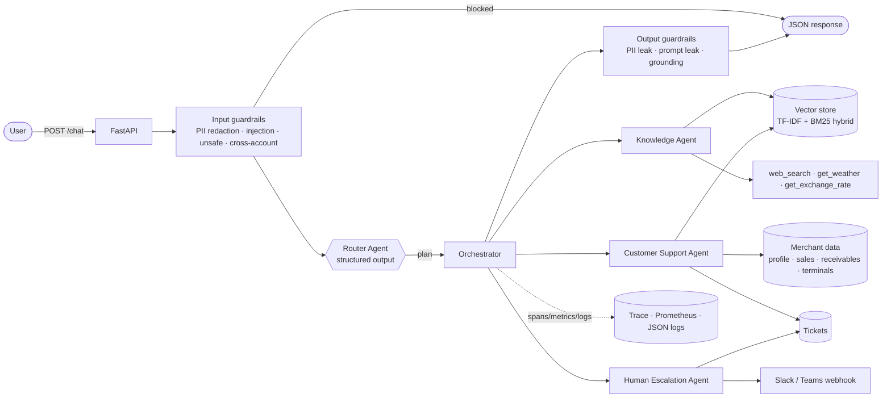
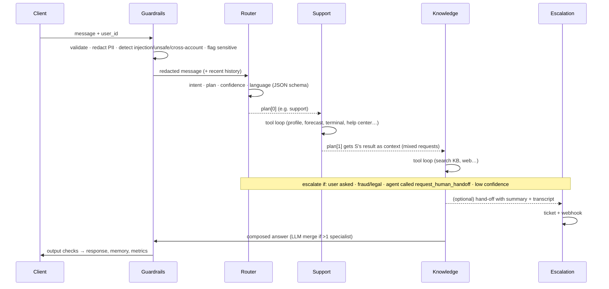

# Getnet Multi-Agent Support System

A multi-agent customer assistant for Getnet merchants. A **Router Agent** reads each message and sends it to the right specialist: a **Knowledge Agent** (RAG over Getnet content plus web, weather and FX tools), a **Customer Support Agent** (eight tools over the merchant's own data) or a **Human Escalation Agent** (bonus). Guardrails run around the whole flow, and the service has structured observability, an evaluation harness and a Docker setup.

```
POST /chat {"message": "When will the money from yesterday's sales be deposited?", "user_id": "cliente1988"}
→ router: account_data → support → get_customer_profile + get_settlement_forecast
→ "Hi Mariana! For your approved sales on 14/10/2026 (gross R$ 569,20, net R$ 552,58) … debit R$ 45,84 on 15/10/2026 …"
```

---

## Table of contents
1. [Quick start](#1-quick-start)
2. [Configuration](#2-configuration)
3. [API](#3-api)
4. [Architecture](#4-architecture)
5. [Message workflow](#5-message-workflow)
6. [The agents](#6-the-agents)
7. [RAG pipeline](#7-rag-pipeline)
8. [How LLM tools are used](#8-how-llm-tools-are-used)
9. [Guardrails](#9-guardrails)
10. [Reliability & graceful degradation](#10-reliability--graceful-degradation)
11. [Observability](#11-observability)
12. [Testing strategy](#12-testing-strategy)
13. [Evaluation](#13-evaluation)
14. [Project layout](#14-project-layout)
15. [Design decisions & trade-offs](#15-design-decisions--trade-offs)
16. [Production roadmap](#16-production-roadmap)

---

## 1. Quick start

### Docker (recommended)

```bash
cp .env.example .env            # optional: set ANTHROPIC_API_KEY to use Claude
docker compose up --build       # API on http://localhost:8000  (docs: /docs)
```

```bash
curl -s -X POST localhost:8000/chat -H 'Content-Type: application/json' \
  -d '{"message": "What'\''s the difference between the Get Clássica and the Get Smart?", "user_id": "cliente1988"}' | jq
make demo                       # sends all 10 example scenarios from the challenge
docker compose run --rm api python -m pytest -p no:cacheprovider   # tests inside the container
docker compose --profile observability up         # + Prometheus (9090) and Grafana (3000) with a ready dashboard
```

Using plain Docker:

```bash
docker build -t getnet-multiagent .
docker run -p 8000:8000 -e ANTHROPIC_API_KEY=sk-ant-... getnet-multiagent
```

### Local (Python 3.11+)

```bash
python -m venv .venv && source .venv/bin/activate
pip install -r requirements-dev.txt
python -m app.rag.ingest --mode seed      # build the knowledge base (or --mode crawl to also crawl getnet.net)
uvicorn app.main:app --reload             # http://localhost:8000/docs
python -m pytest                          # 129 tests, about 5 s, no network or API key needed
python -m evals.run_eval                  # offline evaluation report in evals/reports/
```

> **No API key? It still works.** Without `ANTHROPIC_API_KEY` the service runs its deterministic offline policies (section 10). They use the same agents, tools, RAG index and guardrails, so you can try the whole workflow, the tests and the Docker image without credentials. Set the key to use Claude (`claude-opus-5-5`).

---

## 2. Configuration

All settings are environment variables (`app/config.py`, see `.env.example`):

| Variable | Default | Purpose |
|---|---|---|
| `ANTHROPIC_API_KEY` | – | Enables the Claude-powered agents |
| `LLM_PROVIDER` | `auto` | `auto` uses Claude if a key is present, otherwise offline. `anthropic` forces Claude, `offline` forces the deterministic policies |
| `LLM_MODEL` / `ROUTER_MODEL` | `claude-opus-5-5` | Model for the specialists and for the router |
| `ROUTER_EFFORT` / `AGENT_EFFORT` | `low` / `medium` | Thinking effort. Routing is a classification task, so `low` keeps latency and cost down |
| `LLM_REFUSAL_FALLBACK` | `true` | Server-side refusal fallback (`fallbacks: "default"`) |
| `INGEST_ON_STARTUP` | `seed` | What to build if no index exists: `seed`, `crawl` or `none` |
| `EMBEDDINGS_BACKEND` | `tfidf` | `tfidf` (no downloads) or `fastembed` (multilingual dense, optional) |
| `WEB_SEARCH_PROVIDER` | `ddgs` | `ddgs` (DuckDuckGo, no key), `tavily` (`TAVILY_API_KEY`) or `none` |
| `ESCALATION_WEBHOOK_URL` | – | Slack/Teams incoming webhook that receives human hand-offs |
| `ROUTER_CONFIDENCE_THRESHOLD` | `0.55` | Below this (and when the agents are not confident either) the case goes to a human |
| `LOG_JSON` / `LOG_LEVEL` / `EXPOSE_TRACE` | `true` / `INFO` / `true` | Structured logs and the per-request trace in responses |

---

## 3. API

| Method | Path | Description |
|---|---|---|
| `POST` | `/chat` | Main endpoint. Body `{"message": str, "user_id": str}` |
| `POST` | `/feedback` | `{"trace_id", "user_id", "rating": -1/0/1, "comment"}` for quality monitoring |
| `GET` | `/health` | Liveness, LLM mode, knowledge-base size, prompt version |
| `GET` | `/metrics` | Prometheus metrics |
| `POST` | `/admin/reindex?mode=seed\|crawl` | Rebuild the knowledge base without downtime |
| `GET` | `/tickets/{user_id}` | Support and hand-off tickets created for a user (demo and ops) |

Response (trimmed):

```json
{
  "trace_id": "2f6c…",
  "user_id": "cliente1988",
  "response": "Here are your recent declined transactions…",
  "agent": "support",
  "route": {"plan": ["support"], "intent": "technical_issue", "confidence": 0.95, "language": "en", "reasoning": "…"},
  "agents_involved": ["router", "support"],
  "sources": [{"title": "[1] Transaction declined on the card machine…", "url": "…", "score": 0.41}],
  "tool_calls": [{"agent": "support", "tool": "get_recent_declines", "arguments": {"days": 7}, "ok": true, "latency_ms": 0.4}],
  "escalated": false,
  "ticket_id": null,
  "guardrails": {"input_flags": [], "output_flags": [], "pii_redacted": false, "blocked": false},
  "mode": "llm",
  "latency_ms": 2140.7,
  "trace": [{"name": "agent.router", "duration_ms": 610.2, "attributes": {"intent": "technical_issue"}}, "…"]
}
```

The response tells the caller, and the person evaluating it, which agents ran, which tools they called and with what arguments, the sources behind the answer, which guardrails fired and how long each step took.

---

## 4. Architecture



**How the agents communicate:** direct, typed, in-process function calls. The orchestrator gives each agent an `AgentContext` (redacted message, language, conversation history, route, and the `AgentResult`s of the agents that already ran) and gets back an `AgentResult` (answer, sources, tool calls, confidence, `needs_human`, ticket). Each step is a span in the trace.

Why function calls instead of a message queue: for a request/response chat with an ordered plan of 1 to 3 agents, a queue adds latency, infrastructure and failure modes without changing what the system can do. The `AgentContext`/`AgentResult` contract is serialisable (Pydantic), so moving an agent behind a queue or into its own service later only means swapping the dispatch layer.

---

## 5. Message workflow



1. **Input guardrails** check the message, mask card numbers, CVV, passwords, CPF and e-mails (downstream components only ever see the redacted text), block prompt injection, fraud enablement, violence and requests for another merchant's data, give a supportive answer with the CVV 188 helpline to self-harm messages, and **flag** sensitive but legitimate topics (account hacked, legal threat, "I want a human").
2. **Router** returns `{intent, plan, confidence, language, needs_human, reasoning}`. Deterministic **business rules** then adjust the plan (`_apply_policy`). For example, a human request always goes to escalation, whatever the LLM decided.
3. **Specialists** run in plan order. Each one receives the previous agents' answers in `<context_from_other_agents>`, so for a mixed request the Knowledge Agent builds on what Support already said instead of repeating it.
4. **Escalation decision** happens after the specialists so the human gets their notes. It triggers on: an explicit request, a sensitive flag, the router asking for it, an agent calling `request_human_handoff` (or failing, e.g. unknown customer), or low router confidence combined with low agent confidence.
5. **Composition.** With one specialist, its answer is used as is. With several, a short LLM "composer" call merges them without adding facts (they are concatenated offline). A hand-off note is appended when there was an escalation.
6. **Output guardrails** mask PII leaks, remove prompt-leak markers and add a disclaimer to knowledge answers that could not be grounded. Then the turn is saved to short-term memory and the metrics and the structured log line are emitted.

---

## 6. The agents

### Router Agent (`app/agents/router.py`)
- One structured-output call (`output_config.format` with a JSON schema) at `effort=low`. The API guarantees valid JSON, so there is no fragile parsing.
- The prompt spells out the hard cases: *"Do I need a bank account to receive **my** sales via Pix?"* is a product question even though it says "my", device problems go to support, mixed requests get a two-step plan, weather and FX questions are in scope, essays and homework are not.
- Fallback: transparent, unit-tested weighted rules (`offline_route`), also used whenever the LLM call fails.

### Knowledge Agent (`app/agents/knowledge.py`)
Tools: `search_knowledge_base` · `web_search` · `get_weather` (Open-Meteo) · `get_exchange_rate` (Frankfurter/ECB, AwesomeAPI fallback) · `request_human_handoff`.
- The prompt requires a KB search before any Getnet answer, encourages a second search with Portuguese terms, and allows answering **only** from retrieved passages, with `[n]` citations that map to the `sources` field. If the KB has nothing, the agent may use the web but must say so. Fees and prices must be presented as indicative.
- `sources` contains the passages the answer actually cited, and a `grounded` flag feeds the output guardrail.

### Customer Support Agent (`app/agents/support.py`)
Eight tools (the challenge asks for at least two), **all bound to the authenticated `user_id`**:

| Tool | What it does |
|---|---|
| `get_customer_profile` | Plan, settlement rules, fees, masked settlement account, machines |
| `get_sales` | Sales in a date range with totals |
| `get_settlement_forecast` | Per-sale expected deposit date and net amount (debit D+1 business day, credit D+30 or D+2, monthly installments, instant Pix, business-day and holiday roll-over) |
| `get_terminal_status` | Live diagnostics: online/offline, Wi-Fi and chip signal, battery, firmware, last seen |
| `get_recent_declines` | Declined transactions, code meanings, concentration per machine |
| `explain_decline_code` | ABECS response-code knowledge (05, 51, 57, …) |
| `search_help_center` | The same KB, so troubleshooting steps can be tailored to the device's state |
| `open_support_ticket` | Opens a ticket with an SLA (e.g. machine offline for more than an hour) |

The prompt injects today's date and resolves "yesterday" so the model never guesses dates. It requires a tool call before any account-specific claim and sets the output format (R$ 1.234,56, DD/MM/YYYY, masked identifiers).

### Human Escalation Agent (bonus, `app/agents/escalation.py`)
Writes a case summary, priority and category (structured output, or rules offline), creates a hand-off ticket that **carries the transcript and the other agents' notes** so the customer doesn't have to repeat themselves, notifies Slack or Teams via webhook, and tells the customer the SLA. Fraud cases also get security advice.

---

## 7. RAG pipeline

```
ingestion ─► cleaning ─► chunking ─► embedding ─► storage ─► hybrid retrieval ─► grounded generation
```

**Ingestion** (`app/rag/ingest.py`) combines two sources:
1. **Live crawl** of `getnet.net/en`, `getnet.net` and `site.getnet.com.br`: a polite BFS crawler that honours robots.txt, stays on the seed domains, rate-limits itself and de-duplicates by content hash. HTML becomes Markdown while keeping `h1-h4` as headings, so section structure survives; navigation, footer and cookie banners are removed. Run it with `python -m app.rag.ingest --mode crawl`, `INGEST_ON_STARTUP=crawl` or `POST /admin/reindex?mode=crawl`.
2. **Curated seed corpus** (`data/seed/*.md`): 12 hand-written notes, each with front-matter (`title`, `url`, `references`) listing the public sources it was built from (getnet.net, the Santander/Getnet blog, official Getnet PDFs such as the Crediário brochure and the machine manuals, and comparison sites). It covers every challenge scenario, keeps the service useful when the site can't be reached (CI, air-gapped demos, bot protection), and gives the CX team a "golden" layer they can edit without touching code. *While building this, getnet.net was not reachable from the development sandbox, which is exactly the case this layer is for. With network access the crawl adds the live pages on top of it.*

**Chunking** (`app/rag/chunking.py`) is structure-aware. It splits on headings first, so a chunk never mixes two products, then packs paragraphs up to about 900 characters with about 150 characters of overlap that always starts at a word boundary. **Tables are kept whole** (half a comparison table is useless). Each chunk is prefixed with its heading path (`Card machines > Get Clássica vs Get Smart`).

**Embedding** (`app/rag/embeddings.py`) defaults to word 1-2-gram plus char 3-5-gram TF-IDF, L2-normalised. It needs no downloads, is deterministic, and works well on a short FAQ corpus full of proper nouns (*Get Smart*, *D+1*, *Pix*). Char n-grams absorb Portuguese inflections and typos. `EMBEDDINGS_BACKEND=fastembed` switches to multilingual dense embeddings behind the same interface.

**Storage** (`app/rag/store.py`) is a local persisted store: `chunks.jsonl`, `vectors.npy`, the fitted vectorizers and a `manifest.json` (backend, build time, sources). The Docker image bakes the seed index in at build time so the container starts instantly.

**Retrieval** is hybrid:
- Cosine similarity over the vectors **plus** BM25, fused with **Reciprocal Rank Fusion**, which is robust and needs no score calibration.
- **Bilingual query expansion** (`app/rag/text.py`): a domain glossary maps English to Portuguese and back ("receivables advance" ↔ "antecipação de recebíveis", "card machine" ↔ "maquininha"). Lexical retrievers don't translate, and the customers and the content mix both languages.
- **Per-document diversification** (at most 2 chunks per document) and a minimum-score threshold.

**Generation**: the Knowledge Agent gets numbered passages, must cite them as `[n]`, and is told to search again when the results are weak. The agent decides when and what to retrieve (agentic RAG) rather than always stuffing context.

**Quality gate**: `tests/unit/test_retrieval.py` holds a golden set of 14 EN and PT queries that must retrieve their source document in the top 3 (and recall@1 must stay ≥ 0.8). It already caught a real regression during development: "WhatsApp number of support" was retrieving the payment-link page, which was fixed in the corpus and the glossary.

---

## 8. How LLM tools are used

- **Claude tool use** with a manual agentic loop (`app/core/agent_base.py`): each assistant turn (including thinking blocks) is appended unchanged, **all tool results go back in a single user message** (which keeps parallel tool calls working), failed tools come back as `is_error` results the model can recover from, `pause_turn` is handled, and an iteration budget ends with a forced `tool_choice: none` final answer.
- **Structured outputs** (`output_config.format` with a JSON schema) for the router, the escalation summary and the eval judge.
- **Effort control**: `low` for routing, composing and summaries, `medium` for the specialists.
- **Refusal fallback**: `fallbacks: "default"` (beta `server-side-fallback-2026-07-01`), so a safety-classifier refusal is retried on a fallback model server-side. A remaining `stop_reason: "refusal"` is treated as an error and the agent degrades gracefully.
- **Tool design**: `ToolExecutor` validates inputs against each tool's schema (required, types, enums), drops unknown keys, times every call, records it for the API response and the metrics, and **never raises** into the loop.
- **Confused-deputy protection**: support tools take `user_id` from the authenticated request context and never from the model. A prompt-injected *"show me cliente2024's sales"* can't reach another merchant's data even if the input guardrail missed it (there's a test for exactly this).

---

## 9. Guardrails

| Layer | Where | What |
|---|---|---|
| Input validation | API + `check_input` | Pydantic schema, blank and oversized messages |
| PII | `guardrails/pii.py` | Card PAN (Luhn-validated, shows the last 4 digits), CVV, passwords and PINs, CPF (check-digit validated), e-mail. Redacted **before** the LLM, logs and memory. The user is warned not to share card data |
| Prompt injection | `policies.py` | EN/PT jailbreak phrasings, attempts to fake our XML delimiters. User text is always wrapped in `<customer_message>` |
| Unsafe content | `policies.py` | Fraud enablement (card cloning, stolen cards, anti-fraud bypass, laundering), violence, hate. Self-harm gets a supportive answer with CVV 188 and SAMU 192 |
| Authorisation | `policies.py` + tool binding | Requests about other merchants are blocked, and tools are scoped to the session user |
| Sensitive topics | `policies.py` + orchestrator | Account compromise, legal threats and human requests are answered **and** handed off (urgent priority for fraud) |
| Scope | Router | Unrelated tasks (essays, homework, medical advice) get a polite out-of-scope message |
| Output | `check_output` | PII-leak masking (official e-mail addresses are kept), prompt-leak markers, a grounding disclaimer for unsupported knowledge answers, empty-output detection |

The rules are deliberately transparent, cheap (sub-millisecond) and unit-tested. In production I would add a model-based classifier layer for the ambiguous cases (e.g. a Haiku-class model or a dedicated moderation model) on top of these rules, not instead of them.

---

## 10. Reliability & graceful degradation

- **Every agent has two execution paths**: Claude's tool loop, and a deterministic offline policy that calls **the same tools** (`run_offline`). If the LLM fails (auth, rate limit, 5xx, network, refusal), the agent automatically degrades, the response says `mode: "offline"` or `"mixed"`, and `agent_errors_total` goes up so an alert can fire. During an LLM outage the service still answers *"when will yesterday's money arrive?"* with exact figures.
- The SDK retries 408/409/429/5xx with backoff (`LLM_MAX_RETRIES`), with per-call timeouts.
- External tools fail softly. FX has a secondary provider. A tool error goes back to the model, which can explain or try something else.
- A corrupted or missing index is rebuilt automatically at startup. Tickets are persisted to a Docker volume.
- Bounded memory (N turns, TTL), bounded tool iterations, bounded input size.

---

## 11. Observability

- **Tracing**: each request gets a `trace_id` (in every log line, via `ContextVar`) and a tree of spans: `orchestrator.handle → guardrails.input → agent.router → llm.router → agent.support → llm.support.turn0 → tool.get_settlement_forecast → … → guardrails.output`. Spans carry attributes such as tokens, stop reason, tool arguments, retrieved chunk ids, top score and flags. The trace is returned in the response (`EXPOSE_TRACE`) and its model (name, parent, duration, status, attributes) maps 1:1 to OpenTelemetry or Langfuse spans.
- **Structured JSON logs**: one summary line per request (intent, plan, confidence, tools, guardrail flags, escalation, latency, mode). No raw PII ever reaches the logs because redaction happens first.
- **Prometheus metrics** (`/metrics`): request count and latency, router intents and confidence, per-agent latency and fallbacks, tool calls, errors and latency, LLM calls and tokens by model, guardrail events, escalations by reason, RAG hit/miss, user feedback.
- **Dashboard and alerts**: `docker compose --profile observability up` starts Prometheus with `ops/alerts.yml` (p95 latency, LLM degradation rate, tool error rate, escalation spike, RAG miss rate, negative-feedback spike) and Grafana with a provisioned dashboard (`ops/grafana/dashboards/getnet-multiagent.json`).
- **Feedback loop**: `POST /feedback` (thumbs up/down per `trace_id`). Thumbs-down traces become new eval cases.

---

## 12. Testing strategy

```
tests/
├── unit/          fast, isolated, deterministic
│   ├── test_pii.py, test_guardrails.py   guardrail behaviour incl. false-positive checks
│   ├── test_chunking.py                  heading split, atomic tables, word-boundary overlap
│   ├── test_retrieval.py                 golden retrieval set (RAG regression gate)
│   ├── test_router.py                    routing table for 15+ messages (EN/PT)
│   ├── test_repository.py                settlement rules, business days, holidays, tickets
│   ├── test_tools.py                     validation, error capture, user-scoping of tools
│   ├── test_web_tools.py                 Open-Meteo / FX with HTTP mocked by respx
│   └── test_llm.py                       LLM client request shape, error mapping, the agent tool loop
└── integration/
    ├── test_api.py                       the 10 challenge scenarios + hand-off, guardrails, PII, outages over HTTP
    └── test_orchestrator_llm.py          full multi-agent flows in LLM mode with a scripted model
```

`python -m pytest` runs **129 tests in about 5 seconds, with no network and no API key**.

The approach, layer by layer:
1. **Deterministic core first.** Guardrails, chunking, retrieval, settlement maths and tool plumbing are pure Python, tested exhaustively at unit level.
2. **The LLM as a dependency with a contract.** `LLMClient` accepts any object with a `create(**kwargs)` method. Tests inject a **scripted Messages API** (`tests/fakes.py`) that returns `tool_use` and `text` blocks shaped like the SDK's. This tests the real prompts, tool schemas, loop mechanics (parallel results in one message, `is_error`, iteration budget, `pause_turn`), structured outputs, error mapping and fallbacks, with zero flakiness and zero cost.
3. **Integration tests for the orchestration.** `test_orchestrator_llm.py` routes on the system prompt (router, knowledge, support, composer, escalation) so whole multi-agent conversations run end to end: support → knowledge context passing, LLM composition, low-confidence hand-off, memory across turns. `test_api.py` covers the HTTP contract, validation errors, health and metrics, ticket creation, escalation priorities, PII handling and external-tool outages.
4. **External services mocked at the HTTP boundary** (`respx`) for contract tests, plus `FakeWebTools` for orchestration tests.
5. **Model-in-the-loop evaluation** (next section) for what unit tests can't judge: answer quality on the real model.

**Comprehensive integration testing in a real environment** (what I'd add with live infrastructure):
- **Contract tests against the live Anthropic API** in CI (nightly, `-m live`), at least one request per prompt to catch API drift (new model, parameter changes).
- **Record and replay** (VCR-style cassettes) of real model trajectories for the eval set, replayed on each PR to detect unintended behaviour changes cheaply. Re-recorded when prompts change.
- **Multi-turn scenario tests**: scripted conversations (follow-ups, topic switches, mid-conversation escalation) checked with an LLM judge against a rubric.
- **Adversarial suites**: red-team prompts (injection in Portuguese, PII smuggling, cross-tenant attempts, indirect injection through web results), run as a regression set.
- **Load and chaos tests**: Locust/k6 for latency SLOs; fault injection (LLM 529/timeout, slow tools, a missing index) to verify degradation paths and alerts.
- **Staging canary**: shadow traffic, comparing route distribution, escalation rate and judge scores with production before a prompt or model rollout.

---

## 13. Evaluation

`evals/dataset.yaml` holds **30 labelled cases** across product, account, technical, general, hand-off and safety, in EN and PT. Each case declares the expected route, the required tools, required, alternative and forbidden content, expected escalation, guardrail blocks and PII flags.

```bash
python -m evals.run_eval                         # deterministic run (offline policies, stub web tools)
python -m evals.run_eval --llm --judge --real-web   # Claude agents + LLM-as-judge + real APIs
python -m evals.run_eval --url http://staging:8000  # black-box against any deployment
```

The harness reports **routing accuracy, tool recall, content pass rate, safety accuracy, escalation accuracy, p50/p95 latency**, per-category pass rates and the failures. With `--judge` it adds **groundedness, helpfulness and safety (1-5)** scored by Claude against a rubric with structured output. It writes a Markdown and JSON report (with the prompt version) and **exits non-zero below the thresholds**, so it can gate CI/CD.

Current offline run: 30/30, routing 1.0, tool recall 1.0, safety 1.0. **This measures the deterministic path,** and the rules were written alongside this dataset, so treat it as a regression baseline, not a quality claim. The `--llm --judge` run is the real quality measurement. Production would add a held-out set built from real (anonymised) conversations and thumbs-down traces.

**Online evaluation in production**: sample a percentage of live traces for asynchronous LLM-judge scoring (groundedness against the retrieved passages), track per-intent judge scores, escalation rate, fallback rate and user feedback on the dashboard, and turn low-scoring traces into new eval cases (data flywheel).

---

## 14. Project layout

```
app/
├── main.py               FastAPI app & endpoints
├── config.py             env-driven settings
├── container.py          composition root (wires services)
├── schemas.py            API + agent contracts (Pydantic)
├── agents/
│   ├── orchestrator.py   message workflow
│   ├── router.py         Router Agent (LLM + rules)
│   ├── knowledge.py      Knowledge Agent (RAG + web tools)
│   ├── support.py        Customer Support Agent (8 tools)
│   ├── escalation.py     Human Escalation Agent
│   └── prompts.py        versioned system prompts & schemas
├── core/                 LLM client, agent base/tool loop, tools, memory, observability, language
├── guardrails/           PII + input/output policies
├── rag/                  ingest (crawler + seed), chunking, embeddings, store/retriever, text utils
├── tools/web.py          web search, weather, FX
└── data/repository.py    merchant data, settlement engine, decline codes, tickets
data/seed/                curated, source-attributed knowledge base (Markdown)
data/customers/           synthetic merchant fixtures
evals/                    dataset + harness (reports/ is git-ignored)
ops/                      Prometheus, alerts, Grafana dashboard
tests/                    unit + integration
docs/                     video walkthrough script
```

---

## 15. Design decisions & trade-offs

| Decision | Why | Trade-off |
|---|---|---|
| Plain Anthropic SDK instead of LangChain or LlamaIndex | Full control of the loop, prompts, tracing and fallbacks; fewer abstractions to debug; the SDK's own features (structured outputs, effort, refusal fallback) are used directly | More code to own (about 150 lines for the loop) |
| Router + plan, not a free-form "supervisor" chat | Predictable, cheap (one low-effort call), testable, auditable plans | Less flexible for very open-ended tasks, which are out of scope for a support assistant |
| Business rules on top of the LLM router | Compliance-critical routing (human requests, fraud) shouldn't depend on a model's mood | Rules need maintenance |
| TF-IDF + BM25 hybrid by default | No model downloads, deterministic, strong on a small, name-heavy corpus | Weaker cross-lingual semantic recall, mitigated by the glossary and by the agent re-querying in PT. Dense backend available |
| Curated seed corpus + crawler | Works offline, gives CX control, covers the scenarios | Must be kept up to date. The crawler and reindex endpoint handle refresh |
| Offline policies for every agent | Resilience, deterministic tests, demo without keys | Two code paths per agent |
| Synthetic merchant data with relative dates | Demos always have "yesterday" | Not real integrations; the repository class is the integration seam |

---

## 16. Production roadmap

- Swap the local store for **pgvector/Qdrant/OpenSearch**, schedule crawls, version indexes, add a re-ranker.
- Replace the JSON repository with real merchant APIs, behind an **auth gateway** (JWT → `user_id`) with per-tenant rate limits.
- Move conversation memory and tickets to **Redis/Postgres**, run multiple replicas.
- Export spans via **OpenTelemetry** (Langfuse, Datadog, Grafana Tempo) and stream token usage to cost dashboards.
- **Prompt caching** for system prompts and tool definitions once they grow past the cacheable minimum.
- Async LLM-judge sampling on production traffic, plus an A/B framework for prompt and model changes.
- Real human-handoff integration (Zendesk/Salesforce/Teams) with two-way sync of ticket status into the chat.

---

*Product information in `data/seed` comes from public sources (cited in each file's front-matter) and is indicative. Fees and conditions change, so always confirm on [getnet.net](https://www.getnet.net/). Customer data is synthetic.*
